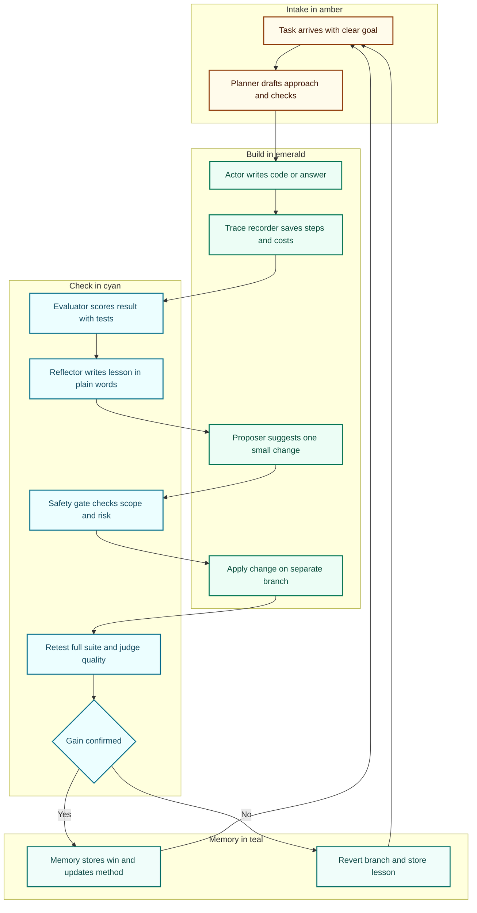
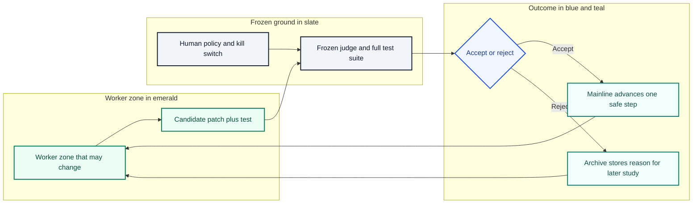
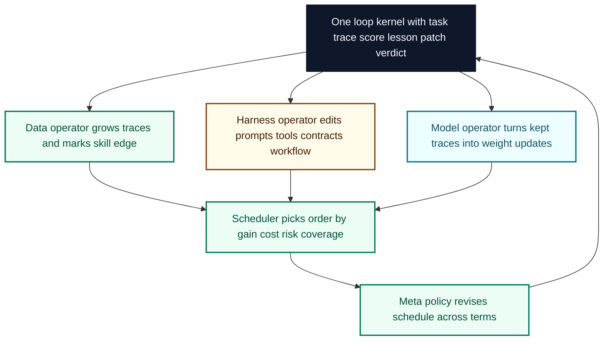
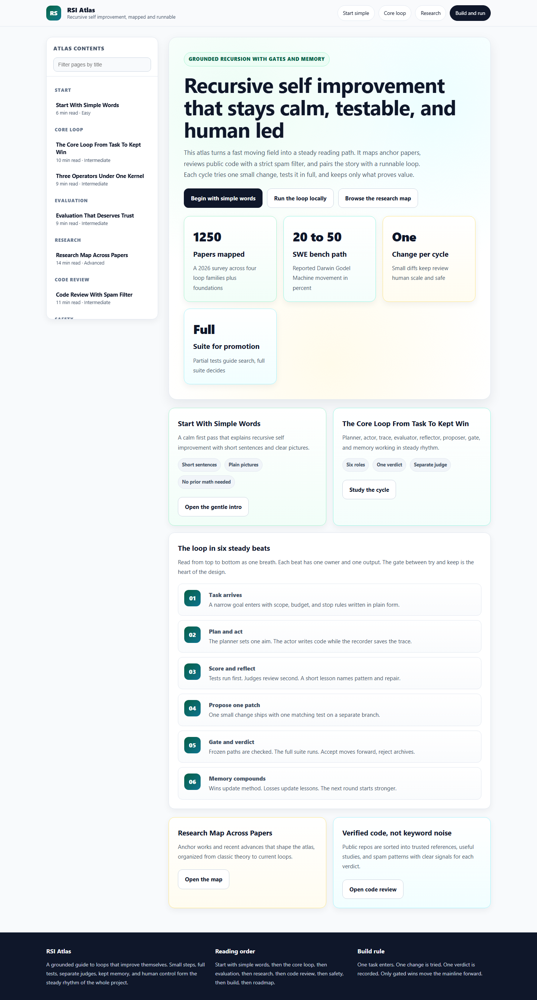
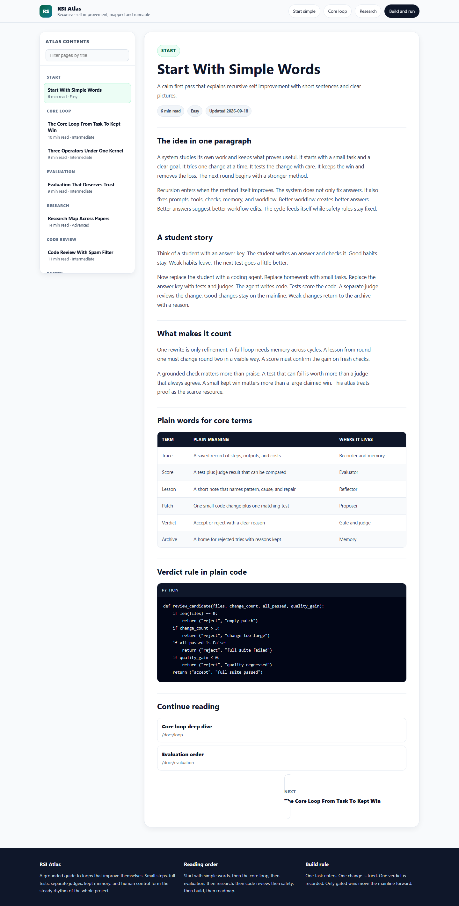

# RSI Atlas

## Recursive Self Improvement, Mapped And Runnable

<p>


</p>

This repository is a complete map and a working model of recursive self improvement for AI systems. The goal is simple to state and deep to build. A system watches its own work. It finds a small change. It tests the change with care. It keeps the change only when the test proves value. Then it repeats the cycle with a stronger self.

The work here combines three streams into one place. The first stream is recent research from arXiv and independent labs. The second stream is public code from GitHub, reviewed with a strict spam filter. The third stream is the direction of the aniruddhaadak80 RSI project, which is a clear description plus a live demonstration of the same architecture. This repo is that live public home. It preserves the idea of describe plus demonstrate, and it adds the context of papers, code quality checks, safety gates, and docs.

Readers who want the short path can start with the simple explanation below. Readers who want depth can move through the architecture, the loop kernel, the evaluation method, the research tables, the repo verification table, and the runnable engine. A Next.js documentation app in the docs folder presents the same material in a calm reading layout with a left sidebar.

## Simple Explanation In Plain Words

Think of a student who checks homework with an answer key. The student writes an answer. The student checks the answer. The student keeps good habits and drops weak habits. The next test goes a little better. That is the core pattern.

Now replace the student with a coding agent. Replace homework with small tasks. Replace the answer key with tests and judges. The agent writes code. Tests score the code. A separate judge reviews the change. Good changes stay. Weak changes are removed. The agent keeps a diary of what worked. The next round starts smarter.

One more step makes it recursive. The agent does not only fix answers. It also fixes the way it fixes answers. It improves prompts, tools, checks, memory, and workflow. Better workflow leads to better answers. Better answers lead to better workflow ideas. The loop feeds itself. Safety rules stay outside the loop so the loop cannot rewrite its own judge.

Simple sentences carry the whole design. Small steps beat large jumps. Tests decide, not hopes. Memory keeps wins. Judges stay separate. Humans stay in control.

## What Counts As Recursive Self Improvement

Many projects use the words self improve. Few meet the full meaning. This atlas uses a firm test. A system counts as recursive when the output of one cycle changes the method of the next cycle. A system counts as self improvement when an external or grounded measure confirms gain across cycles. A demo that only rewrites text once is refinement. A demo that rewrites its own repair skill and then repairs better next time is closer to recursive.

The atlas groups systems into four layers. The behavior layer refines answers at run time with feedback and retry. The training layer turns good traces into weight updates through self data, self reward, or self play. The evaluator layer builds judges, verifiers, reward models, rubrics, and meta checks that decide what good means. The research layer runs agents that propose experiments, run code, read results, and plan the next study. Foundations and safety form the base that holds all four layers honest.

## End To End Flowcharts

The charts below render on GitHub with Mermaid. The first shows the full cycle from task to durable gain with color by stage. Amber marks intake, emerald marks building, cyan marks checking, teal marks memory.



The second chart shows the safety boundary. The judge and the gate stay fixed while the worker changes. Slate marks frozen ground, blue marks review, emerald marks kept progress.



The third chart shows how data, harness, and model operators share one kernel. One loop serves all three surfaces with one artifact vocabulary.



The rhythm is steady on purpose. One task enters. One change is tried. One verdict is recorded. The system moves forward by kept wins, not by claims.

## Architecture In Depth

The architecture has six roles and one memory spine. The planner reads the task and the recent diary and sets a narrow aim for the cycle. The actor does the work with tools for files, tests, search, and execution. The trace recorder saves prompts, outputs, tool calls, costs, and timings in a standard shape. The evaluator scores the trace with deterministic tests first and model judges second. The reflector turns raw scores into a short lesson that names the failure pattern and the repair idea. The proposer turns one lesson into one patch with one new or updated test. Memory stores kept patches, rejected tries, scores over time, cost over time, and open risks.

Separation is the core safety idea. The actor proposes value. The evaluator decides truth. The two roles use different context and different prompts. The same model may play both roles across time, but never in the same verdict without a second check. Promotion needs a full test pass. Partial tests guide search. Only the full suite can promote. The judge code, the gate code, and the loop entry point are marked immutable, so a candidate patch that touches those paths is rejected by rule.

State moves in small typed records. A task record holds goal, scope, budget, and stop rules. A trace record holds steps, artifacts, and costs. A score record holds test results, judge notes, and cost deltas. A lesson record holds pattern, cause, repair, and risk. A patch record holds diff, test plan, and rollback note. A verdict record holds accept or reject plus reasons. This shape keeps the system legible. A new reader can follow any cycle from task to verdict without hunting through logs.

## Loop Kernel

The kernel is deliberately small so it can be audited. It runs one generation at a time. It inspects the source tree. It selects a narrow goal from recent failures or cost gaps. It synthesizes a candidate patch plus a matching test. It applies the patch on a branch. It runs the full suite. It keeps the patch only when every required check passes. It rolls back on any failure and writes structured residue for the next round.

The generator is bounded. It searches over a small set of reusable primitives and recent kept patterns. It cannot invent large new systems in one jump. It favors small edits with clear tests. Accepted improvements feed forward into the next search budget and curriculum difficulty. Rejected tries feed forward as negative lessons. Open ended ideas live in a proposal archive with validation plans. Archive text alone never promotes. Only gated runs promote.

A minimal Python sketch of the verdict logic looks like this. It avoids clever tricks so the rule stays clear.

```python
def review_cycle(candidate, suite, guard):
    if guard.touches_frozen_path(candidate):
        return {"verdict": "reject", "reason": "frozen path touched"}
    if candidate.change_count > 3:
        return {"verdict": "reject", "reason": "change too large"}
    result = suite.run_full()
    if result.all_passed and result.quality_gain >= 0:
        return {"verdict": "accept", "reason": "full suite passed"}
    return {"verdict": "reject", "reason": "suite failed or no gain"}
```

The real engine in the engine folder extends this sketch with history, cost tracking, curriculum growth, and archive handling. The docs app mirrors the same logic in TypeScript for interactive reading.

## Evaluation Method

Evaluation follows a fixed order. Deterministic checks come first because they are cheap and strict. Unit tests, format checks, schema checks, and hidden transfer cases form the base. Model judges come second for qualities that tests cannot see, such as clarity, redundancy, and task fit. Cost and latency come third so gains are weighed against price. A change that helps quality but doubles cost is marked as a trade, not as a pure win. Human review comes last for high risk edits and for release notes.

Meta evaluation keeps judges honest. Judge agreement is tracked across cycles. Judge drift triggers recalibration. A judge that approves everything is treated as broken. A judge that blocks everything is treated as stuck. Calibration sets with known good and known bad cases run on a schedule. The loop can improve workers and prompts, but it cannot silently lower the bar.

## Research Landscape

The field is moving fast. A July 2026 survey organizes about 1250 arXiv papers from 2024 through 2026 into deployment evolution, training iteration, self evaluation, auto research, and foundations with safety. The survey makes one clean cut. Bounded refinement improves behavior against a fixed external check. Open ended recursion also changes the method and the criteria. The second path is far less proven and far more brittle. The atlas follows that cut and treats grounded checks as the scarce resource.

The table below collects anchor papers and recent advances that shape this build. Every row carries a clickable link so anyone can open the source and verify the claim.

| Paper | Year | Core idea | Why it matters for this atlas | Link |
|---|---|---|---|---|
| Godel Machines by Schmidhuber | 2003 | Self rewrite only after proof of utility, with global optimality framing | Sets the classic ideal of provable self change and explains why practice uses empirical gates instead | [Verify](https://arxiv.org/abs/cs/0309048) |
| STaR Self Taught Reasoner | 2022 | Bootstrap rationales, keep those that lead to right answers, repeat | Gives the simplest training time loop of generate, filter, finetune, repeat | [Verify](https://arxiv.org/abs/2203.14465) |
| Self Refine | 2023 | One model acts as writer, critic, and reviser in a short loop | Gives the behavior layer pattern for test time repair without new weights | [Verify](https://arxiv.org/abs/2303.17651) |
| Reflexion | 2023 | Verbal reflection stored in episodic memory guides next trial | Gives the memory pattern of lessons that persist across trials | [Verify](https://arxiv.org/abs/2303.11366) |
| FunSearch | 2023 | Pair code generating model with automatic evaluator in evolution | Shows how a strong evaluator plus diversity can find new programs | [Verify](https://arxiv.org/abs/2305.20050) |
| Self Rewarding Language Models | 2024 | Same model generates answers and judges them for preference training | Shows a genuinely recursive training signal and its saturation risk | [Verify](https://arxiv.org/abs/2401.10020) |
| Godel Agent | 2024 | Self referential agent that reads and patches its own runtime code | Gives the runtime self patch model used by many later demos | [Verify](https://arxiv.org/abs/2410.04444) |
| Darwin Godel Machine | 2025 | Archive of agents plus empirical validation on coding benchmarks | Shows open ended search over agent code with SWE bench gains from 20 to 50 percent | [Verify](https://arxiv.org/abs/2505.22954) |
| AlphaEvolve | 2025 | Evolutionary coding agent for science and infra with rich context | Extends FunSearch to full files and multi objective search | [Verify](https://arxiv.org/abs/2506.13131) |
| MetaEvolve | 2026 | Train meta skills for multi round repair with execution rewards | Moves repair skill into the model rather than the scaffold | [Verify](https://arxiv.org/abs/2607.21971) |
| Recursive Self Improvement in AI Survey | 2026 | Taxonomy across behavior, policy, evaluator, and research loops | Supplies the map used to organize this atlas | [Verify](https://arxiv.org/abs/2607.07663) |
| Dream RSI through Evolving Worlds | 2026 | Replay simulator from discovery trees gives cheap off policy feedback | Shows how to cut exploration cost without losing discovery quality | [Verify](https://arxiv.org/abs/2609.14858) |
| Meta N through Emergent Depth | 2026 | Fixed meta operator applied to growing input across layers | Shows depth by convergence with distinct layer roles | [Verify](https://arxiv.org/abs/2608.24735) |
| MetaRSI RSI2 | 2026 | Compose data, harness, and model operators under one loop kernel | Supplies the three operator vocabulary reused in this design | [Verify](https://arxiv.org/abs/2609.06396) |
| Generalized Agent Iteration | 2026 | Formal frame for policy iteration and RSI with grounding dials | Gives language for anchored versus drifting versus self referential loops | [Verify](https://arxiv.org/abs/2609.13406) |
| Recursive Harness Self Improvement | 2026 | Prompt level harness edits guided by pairwise history feedback | Shows context management gains and cost reduction near 60 percent in reported settings | [Verify](https://arxiv.org/abs/2607.15524) |
| RSIAgent | 2026 | Training free multi agent memory construction for new environments | Shows broad then deep exploration with frozen reusable memory | [Verify](https://arxiv.org/abs/2609.15364) |
| The Last AI Built by Humans | 2026 | Roadmap from execution autonomy to recursive meta improvement | Frames scenario needs across science, embodied work, and software | [Verify](https://arxiv.org/abs/2609.11873) |
| Karpathy autoresearch | 2026 | Single file training loop with fixed time budget and keep or revert discipline | Gives the minimal public template of propose, train, evaluate, keep or discard | [Verify](https://github.com/karpathy/autoresearch) |
| Anthropic progress note on RSI | 2026 | Report of high autonomous code share and faster horizons in industry practice | Signals that harness plus model co evolution is now operational work, not only theory | Industry note, see discussion links in docs |

Independent sources add useful texture. Frontier lab notes describe harness plus model co evolution, where better scaffolds yield better traces and better traces train better models. Community essays describe the Karpathy loop as one file plus one metric plus one time box. Safety notes stress sandboxing, human oversight, branch isolation, and immutable judges. This atlas keeps all three lessons visible.

## GitHub Repository Review With Spam Filter

Public RSI repos range from strong systems to thin wrappers. Many repos reuse the same keywords with little code, few tests, no benchmarks, and no history. The atlas applies a strict verification pass before trust. A repo earns trust when it shows runnable code, a clear loop, an evaluator that is separate from the worker, logged runs or benchmarks, recent maintenance, and a license. A repo is marked thin when it shows only prompts, only slides, only a fork with no changes, or only keyword text with no execution path.

The table below records the review outcome at the time of writing. Stars and dates move with time, so the verdict column focuses on structure rather than fame.

| Repository | Signals | Verdict | Link |
|---|---|---|---|
| jennyzzt slash dgm | Large star base near 2200, paper linked, archive search, SWE bench and Polyglot evaluation, active issues | Trusted reference for open ended agent evolution | [Open](https://github.com/jennyzzt/dgm) |
| Arvid pku slash Godel Agent | Paper linked, star base above 200, runnable agent modules, task scripts, clear self patch design | Trusted reference for self referential runtime | [Open](https://github.com/Arvid-pku/Godel_Agent) |
| kayba ai slash recursive improve | Star base above 200, trace capture plus skill plus benchmark plus dashboard plus ratchet loop | Trusted reference for trace driven product loop | [Open](https://github.com/kayba-ai/recursive-improve) |
| karpathy slash autoresearch | Canonical minimal loop, single editable training file, fixed budget, keep or discard discipline, wide fork network | Trusted reference for minimal research loop | [Open](https://github.com/karpathy/autoresearch) |
| sunghunkwag slash self improving research kernel | Bounded loop, immutable guard, full test promotion gate, capability fixtures, proposal archive | Trusted reference for gated promotion and anti cheat design | [Open](https://github.com/sunghunkwag/self-improving-research-kernel) |
| noahshinn024 slash reflexion | Classic verbal reinforcement baseline with strong HumanEval era results | Trusted reference for reflection memory | [Open](https://github.com/noahshinn024/reflexion) |
| az9713 slash recursive self improvement | Program genetic framing with Pareto selection and benchmark docs | Useful study, smaller community, review code before reuse | [Open](https://github.com/az9713/recursive-self-improvement) |
| hankbesser slash recursive agents | Three phase draft critique revision framing with templates | Useful study for scaffold patterns, check maintenance | [Open](https://github.com/hankbesser/recursive-agents) |
| theprint slash nfh self improvement loop | Generator evaluator separation with hard shell guards and branch discipline | Useful study for separation enforcement | [Open](https://github.com/theprint/nfh-self-improvement-loop) |
| hilarl slash recursive selves | Research framing on revision plus evidence | Early stage, watch for runnable depth | [Open](https://github.com/hilarl/recursive-selves) |
| NvlFR slash self evolving agent | Ambitious SEED framing with mapper, auditor, tester, monitor | Early stage, many open issues, verify before reuse | [Open](https://github.com/NvlFR/self-evolving-agent) |
| aumiqx slash curious | Daily creation plus self evolution framing with uniqueness score | Creative study, thin on standard benchmarks | [Open](https://github.com/aumiqx/curious) |
| ai in pm slash Recursive Self Improvement AI Agent | Small Godel inspired framework with multi API notes | Thin, verify tests and runs before trust | [Open](https://github.com/ai-in-pm/Recursive-Self-Improvement-AI-Agent) |
| Generic RSI keyword repos with one commit | Zero stars, zero forks, no tests, no runs, keyword readme only | Spam pattern, do not cite as evidence | Search GitHub with care |

Spam patterns repeat with steady rhythm. Watch for repos that copy a paper abstract with no code. Watch for repos that add RSI to the title but ship only a chat wrapper. Watch for forks with no diff beyond the readme. Watch for benchmark claims with no logs. Watch for agents that judge their own work with no separate check. Watch for update bursts that only touch stars badges. The atlas treats these as noise and keeps them out of the trusted path.

## How This Build Combines All Sources

The survey supplies the map. The trusted repos supply proven mechanics. The RSI project supplies the product intent of describe plus demonstrate. The combination lands as one system with three faces. The README tells the full story in one scroll. The engine runs the loop in Python with gates and memory. The docs app teaches the loop in calm pages with diagrams and tables.

Operator vocabulary follows MetaRSI in plain form. Data RSI grows good traces and marks the edge of skill. Harness RSI edits prompts, tools, contracts, and workflow without touching weights. Model RSI turns kept traces into training updates on a schedule. One loop kernel serves all three. One artifact vocabulary links task, trace, score, lesson, patch, and verdict. A two axis scheduler picks operator order and proposal policy. A meta policy revises the schedule across terms when evidence supports a shift.

Grounding follows the verification hierarchy. Formal checks and full tests rank highest. Held out transfer cases come next. Model judges with calibration come after. Self praise without external check ranks lowest and never promotes alone. This order explains why some loops compound and others collapse into self confirming praise.

## Repository Layout

The layout stays small on purpose. Each folder has one job. Each file can be read in one sitting.

| Path | Purpose |
|---|---|
| README.md | Full atlas narrative with flowcharts, tables, and guides |
| CONTRIBUTING.md | How to propose changes with tests and calm review |
| SECURITY.md | Safety boundary, threat notes, and reporting path |
| engine slash rsi loop dot py | Runnable bounded loop with gates, memory, and archive |
| engine slash requirements dot txt | Minimal Python dependencies for the engine |
| docs slash package dot json | Next.js docs app manifest |
| docs slash app | Routes and layout for the reading experience |
| docs slash components | Sidebar, header, cards, diagrams, and tables |
| docs slash lib | Typed content model for docs pages |
| docs slash public | Static assets for the docs app |

## Quick Start

These steps use short commands and small budgets. They favor reading first and running second.

Phase One covers reading. Open the README flowcharts and the research tables. Open the docs app index and move through the sidebar in order. Keep notes on which loop layer fits the task at hand.

Phase Two covers the engine smoke run. Create a Python virtual environment. Install the engine requirements. Run the loop in dry mode for two generations. Read the generated diary and verdict files. Confirm that rejected tries carry clear reasons.

Phase Three covers the docs app. Move into the docs folder. Install dependencies with a clean cache policy. Run the development server. Open the local address and walk the sidebar from Start through Safety to Roadmap. Confirm that no page uses harsh contrast or loud color.

Phase Four covers a first safe experiment. Pick one narrow task with a fast test. Add one fixture. Run one generation with a small change budget. Keep the patch only when the full suite passes. Archive the rest with reasons. Share the diary entry with a reviewer.

## Engine Notes

The engine favors clarity over speed. It stores state as JSON so history can be read without special tools. It writes one folder per generation with task, trace, score, lesson, patch, and verdict files. It enforces frozen paths for judge code, gate code, and entry points. It caps patch size to keep review human scale. It tracks cost per generation so quality gains can be weighed with honesty.

Curriculum growth is gentle. When a generation succeeds, the next generation may raise difficulty by one notch. When a generation fails twice on the same pattern, difficulty steps down and the lesson archive grows. Degenerate tasks with no hidden check are rejected at creation time. This keeps the loop from gaming its own school.

## Docs App Notes

The docs app uses Next.js App Router with a fixed left sidebar on desktop and a calm top bar on small screens. The palette rests on slate, emerald, teal, amber, cyan, and warm neutrals. There is no harsh neon and no loud gradient. Type scale is steady. Spacing is generous. Cards use soft borders and quiet shadows. Diagrams use CSS and SVG so pages stay fast without heavy libraries.

Content model is typed. Each doc page has a slug, title, summary, reading time, difficulty, updated date, sections with headings and paragraphs, tables with headers and rows, code samples with language and text, links with labels and targets, and next plus previous navigation. The sidebar groups pages into Start, Core Loop, Evaluation, Research, Code Review, Safety, Build, and Roadmap. Search filters by title and summary on the client without a server round trip.

## Safety And Governance

Safety is a property of the boundary, not a hope about the worker. The worker may be creative. The boundary stays strict. Sandboxing limits file writes to the working branch. Network access is off by default for loop runs. Secrets never enter prompts or traces. High risk patches need human approval. A kill switch stops the scheduler at once. Rollback restores the last kept mainline without manual surgery.

Governance records deserve the same care as code. Every promotion links to tests, scores, costs, and reviewer notes. Every rejection links to reasons and residue. Benchmarks run on held out cases that the generator never sees during search. Judge calibration runs on a schedule with known good and known bad sets. Cost and latency trends are published beside quality trends so trade choices stay visible.

Failure modes get names so teams can spot them early. Self confirming loops approve weak work because the judge shares the worker bias. Model collapse narrows outputs after too much self training without fresh grounding. Diversity collapse fills the archive with near copies of one win. Metric gaming raises a proxy while true quality stalls. Direction drift changes goals without human consent. The atlas answers each with a named guard, from separate judges to frozen paths to human checkpoints.

## Roadmap

Near term work focuses on legibility and small safe wins. The diary format will gain richer cost views. The fixture set will grow across math, code repair, and planning tasks. Judge calibration will gain a visible dashboard. Docs will gain guided paths for students, builders, and reviewers.

Mid term work focuses on composition across operators. Data, harness, and model loops will share schedules with joint budgets. Transfer tests will cover new domains with true held out cases. The archive will support lineage views that show which old win enabled a later breakthrough.

Long term work focuses on measured autonomy. Broader tasks will enter only with stronger sandboxes and clearer stop rules. Meta scheduling will revise operator order from evidence rather than habit. Governance grade measurement will track autonomy, grounding strength, and drift with the same rigor as accuracy.

## Live Deployment

The docs app is deployed for public reading. Open the home page at [aniruddhaadak-rsi.vercel.app](https://aniruddhaadak-rsi.vercel.app) and move through the sidebar from Start to Roadmap. The docs index lives at [aniruddhaadak-rsi.vercel.app slash docs](https://aniruddhaadak-rsi.vercel.app/docs) and the gentle intro lives at [aniruddhaadak-rsi.vercel.app slash docs slash start](https://aniruddhaadak-rsi.vercel.app/docs/start). The source repo lives at [github.com slash aniruddhaadak80 slash RSI](https://github.com/aniruddhaadak80/RSI).

## Site Preview

The shots below show the live reading experience with the left sidebar, calm cards, flow steps, and tables. They are captured from the production deployment so reviewers can see the design without leaving GitHub.

<p>

</p>

The home view above shows the hero, the metric cards, and the six beat loop preview in emerald, teal, amber, and cyan on a soft slate ground.

<p>

</p>

The docs view above shows the fixed left sidebar with grouped contents plus the plain words intro with tables and code.

## Contributing

Contributions are welcome through small focused pull requests. Open an issue first for larger ideas so design can be discussed before code. Keep patches narrow with tests attached. Keep judges separate from workers. Keep costs visible. Write in paragraphs with plain words. Avoid loud styling and avoid harsh color. The full guide lives in CONTRIBUTING.md with the same calm tone.

## License

This project uses the MIT license. Use the code, learn from the diaries, adapt the loop, and share improvements with care. Keep safety gates intact when reusing the engine in new settings.

## Citation

When this atlas helps a project or a paper, cite the anchor works that made it possible alongside this repo. Credit Godel Machines for the classic frame, STaR for bootstrapped reasoning, Self Refine and Reflexion for behavior loops, FunSearch and AlphaEvolve for evaluator driven evolution, Self Rewarding Models for recursive training signals, Godel Agent and Darwin Godel Machine for self referential agents, the 2026 survey for the taxonomy, and the trusted repos for runnable patterns. A short citation file can be added once the remote RSI home is confirmed.

## Closing Note

Progress here is quiet by design. Each kept patch is small. Each diary entry is plain. Each chart moves a little. Over many cycles, small kept wins compound into a stronger method and a clearer record. That steady rhythm is the whole promise of recursive self improvement when it is grounded, gated, and shared.
